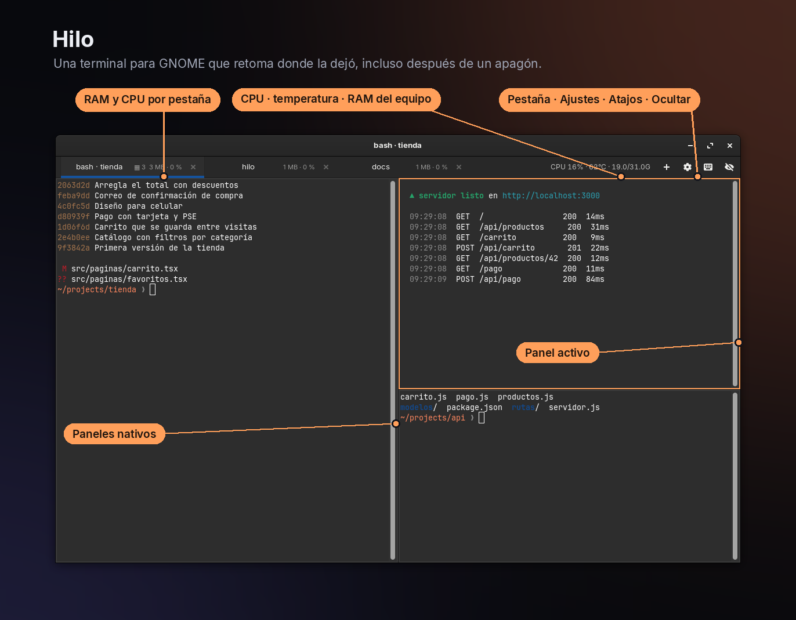
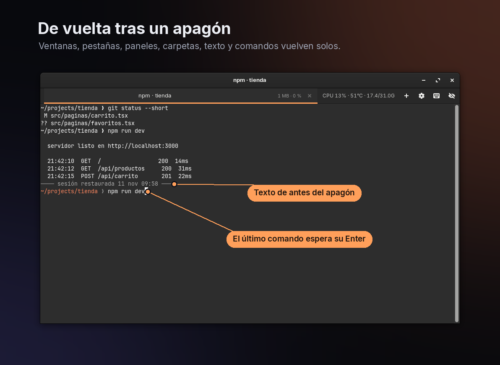
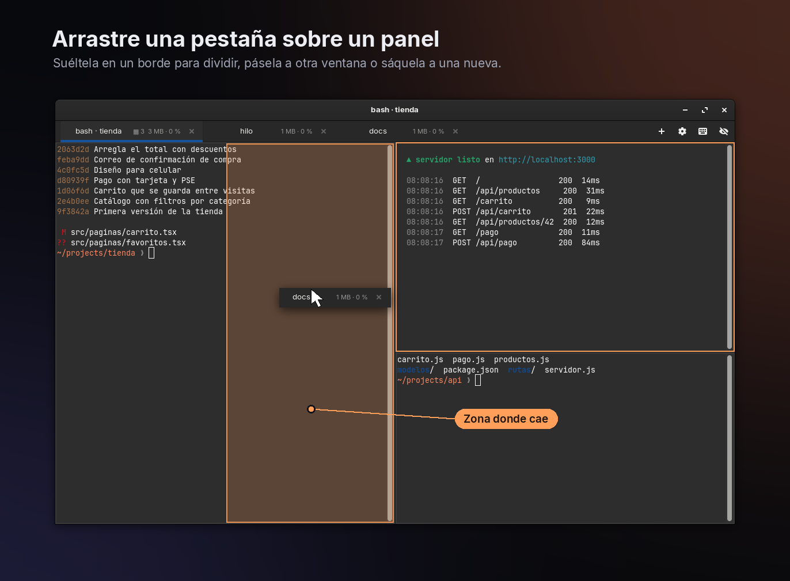
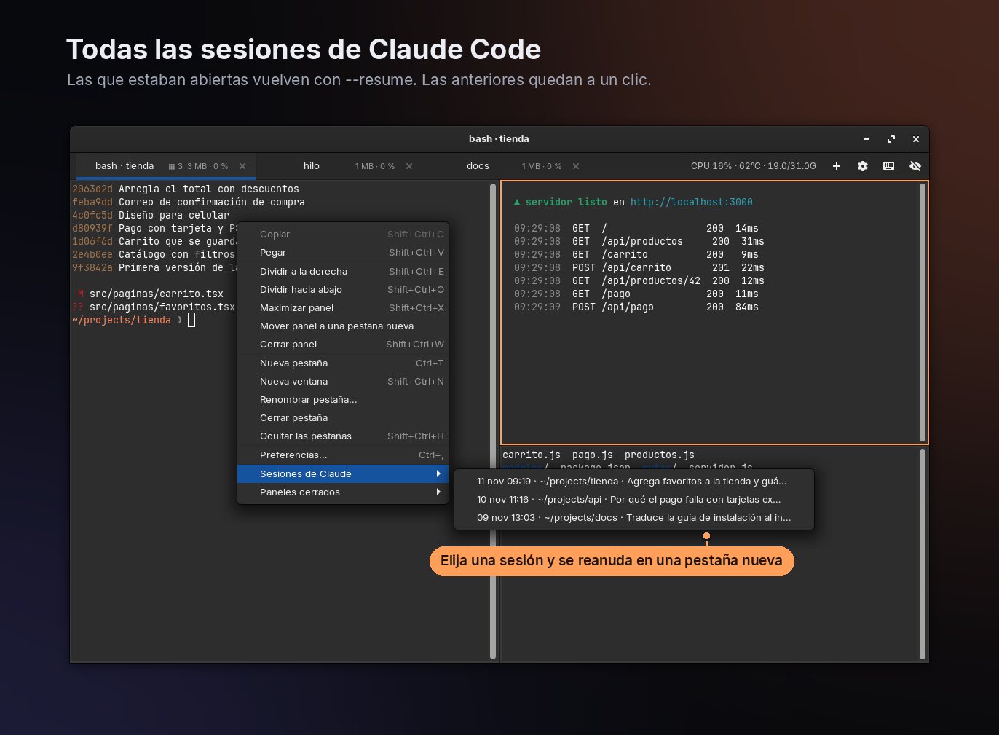
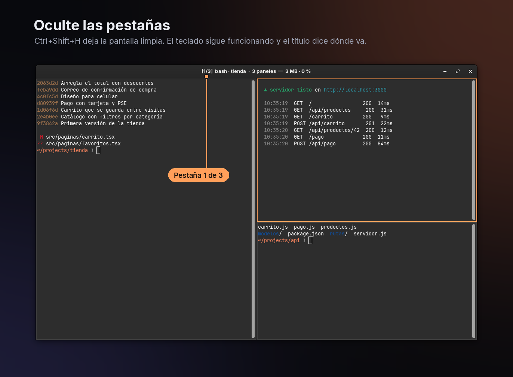
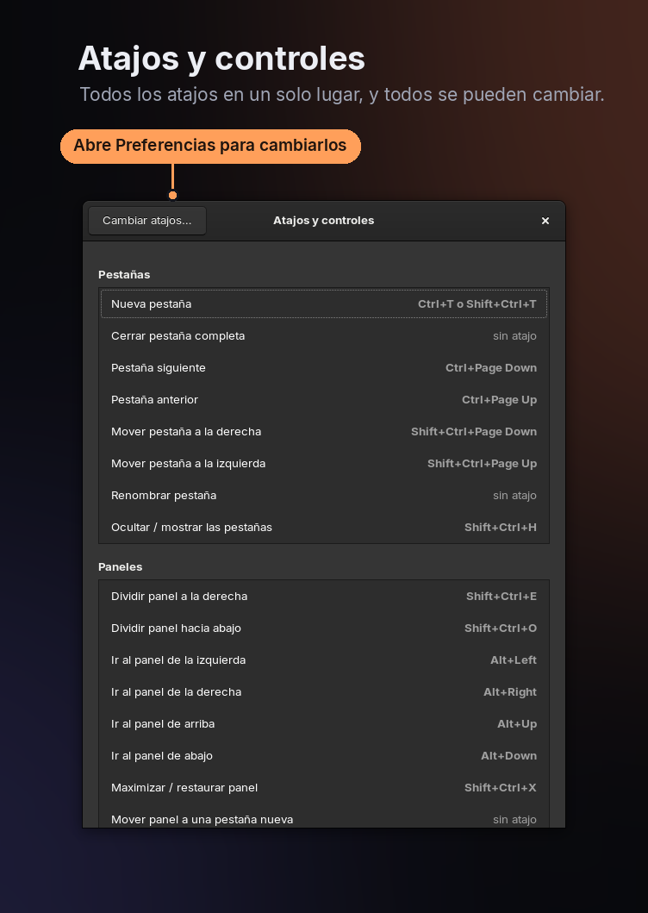

# Hilo

[English](README.md) · **Español**

Terminal para GNOME basada en VTE, el mismo motor de GNOME Terminal, así que se ve y se comporta igual. Además guarda la sesión en disco todo el tiempo, y si el PC se apaga de golpe la recupera al abrirla otra vez.

La interfaz viene en español y en inglés. Sigue el idioma del sistema, y se puede cambiar en Preferencias.



## Qué se recupera



| Qué | Cada cuánto se guarda |
|---|---|
| Ventanas, tamaño, pestañas, orden, pestaña activa y nombres personalizados | al cambiar, y cada 2 s |
| Carpeta de cada pestaña | cada 2 s |
| Comando que estaba corriendo | cada 2 s |
| Texto en pantalla (historial de hasta 10 000 líneas) | cada 10 s, solo si cambió |

Al restaurar:

- **Claude Code** se reanuda solo con `claude --resume <id>`, con las mismas banderas (`--dangerously-skip-permissions`, `--model`…). El id sale de `~/.claude/sessions/<pid>.json`.
- `nvim`, `vim`, `htop`, `btop`, `top`, `less`, `man` y `tail` se vuelven a abrir solos.
- Cualquier otro comando (`bin/dev`, `npm run dev`, `rails s`…) queda escrito en el prompt esperando Enter, para que nada peligroso se ejecute sin que usted lo vea.

Los procesos en sí no pueden sobrevivir a un corte de luz, porque viven en la RAM. Lo que hace Hilo es reconstruir el entorno.

## Paneles



Cada pestaña se puede dividir en varios paneles. Cada panel es una terminal independiente, con su propia shell, carpeta, comando, texto guardado, consumo y sesión de Claude. Todo se restaura tras un apagón con la misma distribución y proporciones.

- **Ctrl+Shift+E** divide a la derecha y **Ctrl+Shift+O** hacia abajo. El panel nuevo abre en la misma carpeta.
- **Alt+←↑→↓** pasa de un panel a otro, o se puede hacer clic. El panel activo lleva un borde naranja.
- **Ctrl+Shift+X** maximiza el panel dentro de la pestaña y lo devuelve a su lugar.
- **Ctrl+Shift+W** o `exit` cierra el panel y los demás ocupan su espacio. Si era el único, se cierra la pestaña.
- La X de la pestaña cierra la pestaña completa.
- Para cambiar el tamaño, arrastre la línea divisoria.
- **Arrastrar una pestaña para volverla panel:** tome la pestaña y arrástrela sobre el área de terminal. Se marca en naranja la mitad del panel donde va a caer (izquierda, derecha, arriba o abajo, según el borde más cercano), y al soltar queda ahí con sus shells vivas. Si la pestaña tenía varios paneles, se mueven todos juntos. Arrastrar dentro de la barra de pestañas sigue sirviendo para reordenarlas.
- **Hacia los paneles de otra pestaña:** mientras arrastra, pase sobre otra pestaña: se marca en naranja y se va llenando, y al llenarse se abre, para soltar en sus paneles. La pestaña abierta conserva su línea naranja, y una guía corta encima de la terminal dice qué hace cada lugar. (Moverse de lado dentro de la barra reordena las pestañas; primero baje la pestaña.)
- **Mover o sacar un panel:** en una pestaña con varios paneles, acerque el mouse al borde de arriba de un panel y aparece el asa **⠿ Arrastrar panel**. Suéltela en otro panel (de esta pestaña o de otra) para ponerlo ahí, en la barra de pestañas para volverlo una pestaña propia en ese lugar, o fuera de toda ventana para abrirlo en una nueva.
- **Entre ventanas:** si la suelta en la barra de pestañas de otra ventana, pasa a esa ventana. Si la suelta sobre el contenido de otra ventana, queda como panel allí. Si la suelta fuera de toda ventana, se abre en una ventana nueva. Una ventana que se queda sin pestañas se cierra sola.
- **Lo inverso:** clic derecho → *Mover panel a una pestaña nueva* lo saca a su propia pestaña, sin cerrar lo que está corriendo (también **Ctrl+Shift+D**).
- En la pestaña aparece `▦ 3` cuando tiene 3 paneles. El consumo que muestra es la suma de todos, y el detalle por panel sale al pasar el mouse.
- La búsqueda, la copia y el pegado actúan sobre el panel activo.

## Historial de Claude y paneles cerrados



Todo esto se conserva aunque cierre la pestaña o la terminal:

- **Sesiones de Claude:** cada sesión que corre en Hilo queda registrada (las últimas 300) con su carpeta, sus banderas, la hora y el primer mensaje que usted escribió, para reconocerla. Para reanudar una, use clic derecho → *Sesiones de Claude*, que la abre en una pestaña nueva en su carpeta, o en la consola `hilo --historial` (o `--history`), que imprime `cd … && claude … --resume <id>` listo para copiar.
- **Paneles cerrados:** al cerrar un panel o una pestaña se guardan el texto, la carpeta y las sesiones de Claude de cada panel (los últimos 40). Para reabrirlo con el texto de antes, use clic derecho → *Paneles cerrados*, o en la consola `hilo --cerradas` (o `--closed`).

Solo se registran las sesiones abiertas desde Hilo, no las de GNOME Terminal. Para esas siempre queda `claude --resume`, que las lista todas.

## Respuestas de Claude en voz alta

Si [piper](https://github.com/rhasspy/piper) y una voz están instalados en `~/.local/share/piper-tts` (`venv/bin/piper` y un archivo `.onnx`), aparece un botón de parlante en la barra de pestañas. Cada respuesta de Claude Code se lee en voz alta apenas termina, una tras otra si responden varias sesiones a la vez.

- **El botón del parlante** abre un panel con lo que está sonando, anterior / pausa / siguiente / detener, el interruptor para encender o apagar la lectura y el historial: un clic en una respuesta la vuelve a leer.
- **Ir a la sesión** salta a la pestaña y al panel exactos donde corre esa sesión de Claude, en cualquier ventana de Hilo.
- La pestaña que está hablando muestra `♪` antes del título, y el icono se pone naranja.
- También funcionan las teclas multimedia y los controles de medios de GNOME.
- Una actualización en caliente no pierde la cola: la respuesta que sonaba empieza otra vez y siguen las demás.
- Solo una Hilo lee en voz alta a la vez, así las copias de desarrollo no hablan.

Claude le avisa a Hilo de cada respuesta con un hook `Stop` que corre `hilo --tts-hook`. Si no está registrado, el panel lo dice y el botón **Reparar** lo agrega a `~/.claude/settings.json` (con copia de seguridad). Las respuestas quedan en `~/.local/share/claude-tts/history.jsonl` aunque la lectura esté apagada, y si existe `~/.claude/tts-off` la lectura está apagada. Ajustes: `tts_model` (ruta a otra voz) y `tts_speed` (menos es más rápido).

## Cuándo se olvida una pestaña

- Escribir `exit`, Ctrl+Shift+W o la X de la pestaña: sale de la sesión, pero queda en *Paneles cerrados*.
- Cerrar la **última ventana** con la X: se recuerda y vuelve la próxima vez.
- Cerrar una ventana cuando hay otras abiertas: se olvida esa ventana.
- Apagado, cierre de sesión o corte de luz: se recuerda.

Para abrir sin restaurar: `hilo --fresh`, o la acción «Abrir sin restaurar» en el menú del icono.

## Atajos

Se cambian en **Preferencias** (Ctrl+, o clic derecho → Preferencias…), pestaña *Atajos*: haga clic en el atajo y presione la combinación nueva. Esc cancela y Retroceso lo deja sin atajo. Si la combinación ya la usaba otra acción, se le quita y aparece un aviso. La flecha ↺ vuelve al atajo original.

Por defecto: Ctrl+T o Ctrl+Shift+T nueva pestaña (en la misma carpeta) · Ctrl+Shift+E / O dividir a la derecha / abajo · Alt+flechas cambiar de panel · Ctrl+Shift+X maximizar panel · Ctrl+Shift+D mover panel a una pestaña nueva · Ctrl+Shift+W cerrar panel · Ctrl+Shift+N nueva ventana · Ctrl+Shift+Q cerrar ventana · Ctrl+Shift+C/V copiar/pegar · Ctrl+Shift+F buscar · Ctrl+RePág/AvPág cambiar de pestaña · Ctrl+Shift+RePág/AvPág mover pestaña · Alt+1…9 ir a pestaña (fijo) · Ctrl + / − / 0 zoom · Ctrl+Shift+H ocultar o mostrar las pestañas · F11 pantalla completa · Ctrl+, preferencias · Ctrl+Shift+? atajos y controles.

**Botones de la barra:** **+** abre una pestaña nueva, el engranaje abre Preferencias y el teclado muestra todos los atajos vigentes y los gestos con el mouse. **Pestañas ocultas:** el botón del ojo oculta la barra completa, botones incluidos. Para volver a verla: Ctrl+Shift+H, o clic derecho → *Mostrar las pestañas*. Con la barra oculta todo sigue funcionando con el teclado, y el título de la ventana dice en qué pestaña va, por ejemplo `[2/5]`. Se recuerda al reabrir.

Además: Ctrl+clic abre enlaces, doble clic en la pestaña la renombra y el clic derecho abre el menú.

**Monitor del equipo:** al final de la barra de pestañas Hilo muestra el uso de CPU, la temperatura del procesador y la RAM usada / total de todo el equipo, por ejemplo `CPU 22% · 71°C · 19.0/31.0G`. La temperatura se pone naranja desde 85 °C. Lee `/proc` y los sensores del kernel, así que no necesita nada adicional.

En *General* se activan o desactivan el consumo en las pestañas, el monitor del equipo, la reanudación automática de Claude y la lista de programas que se vuelven a abrir solos. Ahí también se elige el idioma (automático, español o inglés); el cambio se aplica al momento, sin cerrar nada.





## Actualizar sin reiniciar

Cuando cambia `hilo.py` (por ejemplo, tras un `git pull`), aparece en la barra de pestañas un botón naranja **Actualizar**. Al hacer clic se aplica la versión nueva sin cerrar nada: Hilo se reemplaza por el código nuevo en el mismo proceso y le entrega cada terminal abierta, así que las shells, las sesiones de Claude y los programas siguen corriendo. También se puede con `hilo --actualizar` (o `--update`) desde cualquier terminal, o con clic derecho → *Aplicar actualización de Hilo*.

A los programas a pantalla completa (Claude, vim, less) se les pide que se vuelvan a dibujar. Si la versión nueva tiene un error de sintaxis, no se aplica nada y aparece un aviso.

## Instalar

```sh
./install.sh              # comando `hilo` + acceso en el menú
./install.sh --autostart  # además la abre al iniciar sesión
./install.sh --uninstall
```

Usa la fuente, la paleta y el scrollback del perfil por defecto de GNOME Terminal, y los colores del tema del sistema.

## Archivos

- Sesión: `~/.local/state/hilo/session.json` y `~/.local/state/hilo/scroll/<pestaña>.txt`. Historial: `claude-historial.json` y `cerradas/`, en la misma carpeta. Se escriben de forma atómica (archivo temporal, fsync y rename), así un apagón nunca deja un archivo a medias.
- Configuración: `~/.config/hilo/config.json`. Se maneja desde Preferencias, y solo guarda lo que cambió respecto a los valores por defecto.

```json
{ "language": "auto", "show_usage": true, "show_system": true, "autorun_claude": true, "autorun": ["nvim", "vim", "htop"],
  "shortcuts": { "new_tab": ["<Control>t"], "close_tab": ["<Control><Shift>w"] } }
```

## Límites conocidos

- El texto restaurado vuelve sin colores, porque VTE 0.68 solo exporta texto plano.
- Lo que había en pantalla completa (vim, top) no se guarda como texto. El programa simplemente se vuelve a abrir.
- Se pierden como mucho los últimos ~2 s de cambios de pestañas y ~10 s de texto.

## Contribuir

Vea [CONTRIBUTING.es.md](CONTRIBUTING.es.md): cómo correr una copia de desarrollo sin tocar su sesión, cómo está organizado el código y qué probar antes de proponer un cambio.

## Licencia

MIT. Vea [LICENSE](LICENSE).
