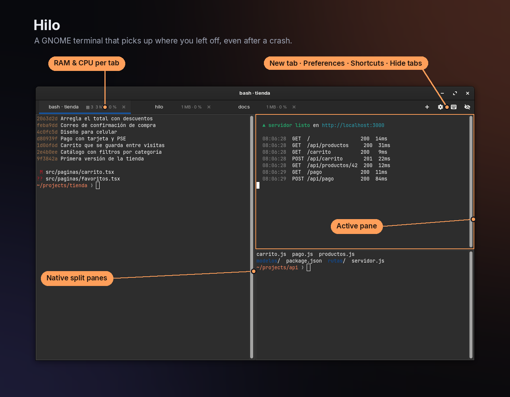
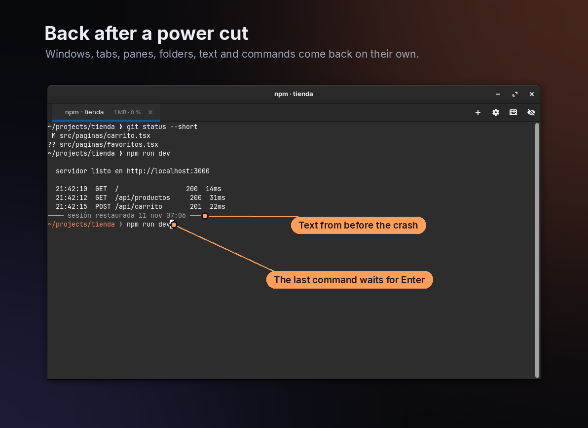
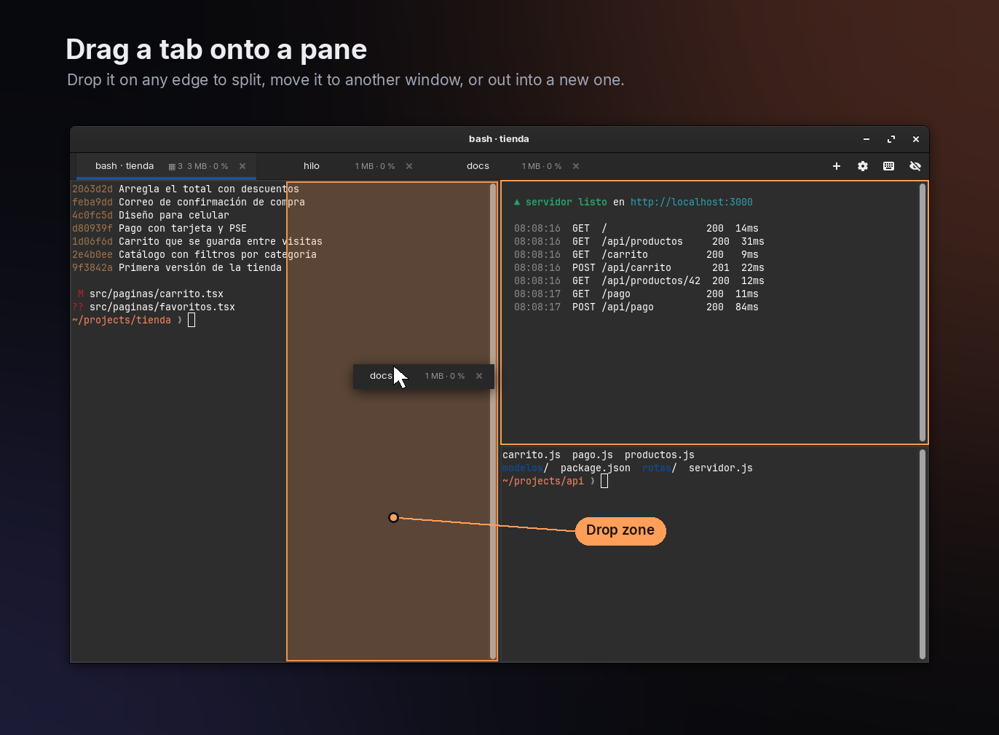
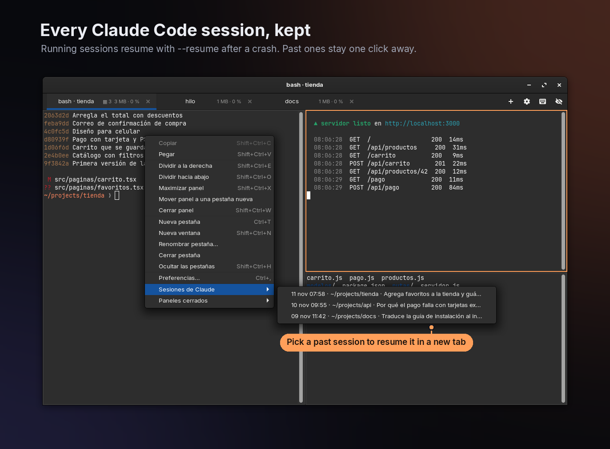
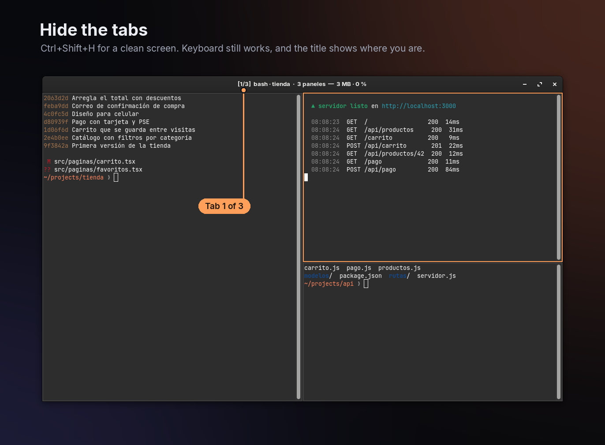
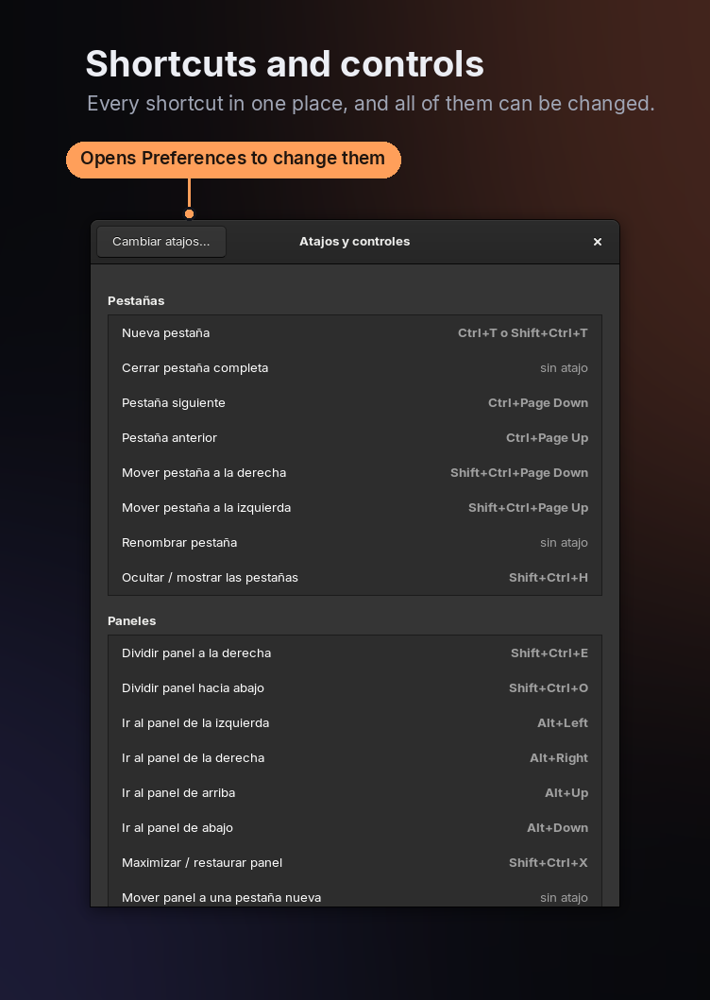

# Hilo

**English** · [Español](README.es.md)

A GNOME terminal built on VTE, the same engine as GNOME Terminal, so it looks and behaves the same. On top of that it keeps saving your session to disk, and if your computer shuts down unexpectedly, everything comes back the next time you open it.

The interface is in Spanish for now.



## What comes back



| What | How often it's saved |
|---|---|
| Windows, size, tabs, order, active tab and custom tab names | on every change, and every 2 s |
| Working directory of each tab | every 2 s |
| The command that was running | every 2 s |
| Text on screen (up to 10,000 lines of scrollback) | every 10 s, only if it changed |

On restore:

- **Claude Code** resumes on its own with `claude --resume <id>`, keeping the same flags (`--dangerously-skip-permissions`, `--model`…). The id comes from `~/.claude/sessions/<pid>.json`.
- `nvim`, `vim`, `htop`, `btop`, `top`, `less`, `man` and `tail` reopen automatically.
- Any other command (`bin/dev`, `npm run dev`, `rails s`…) is typed at the prompt and waits for Enter, so nothing risky runs without you seeing it.

Processes themselves can't survive a power cut, because they live in RAM. What Hilo does is rebuild the environment around them.

## Panes



Every tab can be split into panes. Each pane is an independent terminal with its own shell, directory, command, saved text, resource usage and Claude session. After a crash, everything comes back with the same layout and proportions.

- **Ctrl+Shift+E** splits to the right and **Ctrl+Shift+O** splits down. The new pane opens in the same directory.
- **Alt+←↑→↓** moves between panes, or just click one. The active pane has an orange border.
- **Ctrl+Shift+X** maximizes the pane inside its tab and puts it back.
- **Ctrl+Shift+W** or `exit` closes the pane and the others take its space. If it was the only one, the tab closes.
- The X on a tab closes the whole tab.
- Drag the divider to resize.
- **Drag a tab to turn it into a pane:** grab the tab and drag it over the terminal area. The half of the pane where it will land (left, right, top or bottom, whichever edge is closest) lights up in orange, and when you drop it, it stays there with its shells still running. If the tab had several panes, they all move together. Dragging within the tab bar still reorders tabs.
- **Between windows:** drop a tab on another window's tab bar to move it there. Drop it on another window's content to make it a pane there. Drop it outside any window to open it in a new window. A window left with no tabs closes itself.
- **The other way around:** right click → *Mover panel a una pestaña nueva* (move pane to a new tab) pulls it out into its own tab without stopping what's running.
- A tab with 3 panes shows `▦ 3`. The usage it shows is the sum of all of them; hover to see each pane.
- Search, copy and paste act on the active pane.

## Claude history and closed panes



All of this survives closing the tab or the terminal:

- **Claude sessions:** every session run inside Hilo is recorded (the last 300) with its directory, flags, time and the first message you wrote, so you can recognize it. To resume one, right click → *Sesiones de Claude* (Claude sessions), which opens it in a new tab in its directory, or run `hilo --historial`, which prints `cd … && claude … --resume <id>` ready to copy.
- **Closed panes:** when you close a pane or a tab, Hilo keeps the text, directory and Claude sessions of each pane (the last 40). To reopen one with its old text, right click → *Paneles cerrados* (closed panes), or run `hilo --cerradas`.

Only sessions started from Hilo are recorded, not the ones from GNOME Terminal. For those you still have `claude --resume`, which lists them all.

## When a tab is forgotten

- Typing `exit`, Ctrl+Shift+W or the X on the tab: the session ends, but it stays under *Paneles cerrados*.
- Closing the **last window** with its X: it's remembered and comes back next time.
- Closing a window while others are open: that window is forgotten.
- Shutdown, logout or power cut: it's remembered.

To open without restoring: `hilo --fresh`, or the "Abrir sin restaurar" (open without restoring) action in the app icon's menu.

## Shortcuts

Change them in **Preferences** (Ctrl+, or right click → *Preferencias…*), *Atajos* tab: click a shortcut and press the new combination. Esc cancels and Backspace leaves it without a shortcut. If another action was using that combination, it's removed from it and you get a notice. The ↺ arrow restores the default.

Defaults: Ctrl+T or Ctrl+Shift+T new tab (same directory) · Ctrl+Shift+E / O split right / down · Alt+arrows switch pane · Ctrl+Shift+X maximize pane · Ctrl+Shift+W close pane · Ctrl+Shift+N new window · Ctrl+Shift+Q close window · Ctrl+Shift+C/V copy/paste · Ctrl+Shift+F search · Ctrl+PgUp/PgDn switch tab · Ctrl+Shift+PgUp/PgDn move tab · Alt+1…9 go to tab (fixed) · Ctrl + / − / 0 zoom · Ctrl+Shift+H hide or show tabs · F11 fullscreen · Ctrl+, preferences · Ctrl+Shift+? shortcuts and controls.

**Tab bar buttons:** **+** opens a new tab, the gear opens Preferences, and the keyboard shows every current shortcut plus the mouse gestures. **Hidden tabs:** the eye button hides the whole bar, buttons included. To bring it back: Ctrl+Shift+H, or right click → *Mostrar las pestañas* (show tabs). With the bar hidden everything still works from the keyboard, and the window title shows which tab you're on, for example `[2/5]`. This is remembered across restarts.

Also: Ctrl+click opens links, double-clicking a tab renames it, and right click opens the menu.

Under *General* you can turn the usage display on tabs on or off, toggle automatic Claude resume, and edit the list of programs that reopen on their own.





## Install

Requirements: Linux with GNOME (or any GTK 3 desktop), Python 3.10+, and PyGObject with GTK 3 and VTE 2.91. On Ubuntu and Debian:

```sh
sudo apt install python3-gi gir1.2-gtk-3.0 gir1.2-vte-2.91
```

Then:

```sh
./install.sh              # `hilo` command + app menu entry
./install.sh --autostart  # also open it at login
./install.sh --uninstall
```

It uses the font, palette and scrollback of your default GNOME Terminal profile, and the colors of your system theme.

## Files

- Session: `~/.local/state/hilo/session.json` and `~/.local/state/hilo/scroll/<tab>.txt`. History: `claude-historial.json` and `cerradas/`, in the same folder. They're written atomically (temp file, fsync and rename), so a power cut never leaves a half-written file.
- Settings: `~/.config/hilo/config.json`. Managed from Preferences; it only stores what differs from the defaults.

```json
{ "show_usage": true, "autorun_claude": true, "autorun": ["nvim", "vim", "htop"],
  "shortcuts": { "new_tab": ["<Control>t"], "close_tab": ["<Control><Shift>w"] } }
```

## Known limits

- Restored text comes back without colors, because VTE 0.68 only exports plain text.
- Full-screen programs (vim, top) aren't saved as text. The program simply reopens.
- At most the last ~2 s of tab changes and ~10 s of text can be lost.

## Contributing

See [CONTRIBUTING.md](CONTRIBUTING.md): how to run a development copy without touching your real session, how the code is organized, and what to test before sending a change.

## License

MIT. See [LICENSE](LICENSE).
